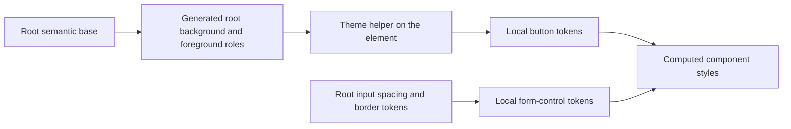

# Theming architecture

chulapa2 uses the CDN distribution of Bootstrap **6.0.0-alpha.2**. Token
names and scopes in this document refer to that release. Use the distributed
CSS as the final reference when the live Bootstrap 6 documentation describes
a newer alpha. [Pinned Bootstrap CSS][bootstrap-dist] · [CSS variables][bootstrap-vars] · [Theme][bootstrap-theme]

## Customization inventory

Chulapa accepted arbitrary Sass variable names through each mode's `vars`
mapping. It imported the selected skin, assigned the configured variables,
applied the optional generator with Sass defaults, and compiled Bootstrap
and Chulapa's own stylesheet. Its generator tinted grays, white and black,
mixed status colors from the primary, and set a few defaults for code,
carousel controls and contrast. Typography, dimensions and most component
settings were explicit Sass overrides. [Chulapa build][legacy-build] · [Chulapa Auto Themer][legacy-auto] · [Chulapa component defaults][legacy-vars]

| Capability in chulapa | Bootstrap 6 in chulapa2 |
| --- | --- |
| Primary, secondary and status palettes | Auto Themer derives the primary, secondary, success, warning, danger and info families from the primary input. Set a different semantic base or override a single role such as `success-bg`. |
| Page background, text, muted text and surfaces | Auto Themer tints `bg-body`, `fg-body` and `bg-1` through `bg-4`. Set those tokens or `fg-3` to customize them directly. Skin defaults can define their own surfaces. |
| Body, monospace and heading typography | Set `body-font-family`, `body-font-size`, `body-font-weight`, `body-line-height`, `font-mono`, `heading-font-family`, `heading-font-weight` and `heading-line-height`. A helper or component that declares its own local font token takes precedence over an inherited value. |
| Border color, width, style and corner radius | Set `border-color`, `border-width`, `border-style` and radius scale tokens such as `radius-5`. Use the component's own token if it defines its border or radius locally. A hardcoded CSS property needs custom CSS. |
| Shadows, spacing and sizing | Set `shadow-strength`, `box-shadow-inset`, `spacer`, size tokens or local component values. Some Bootstrap utilities have values compiled into the distribution. Changing a token updates its consumers only. |
| Link color, hover, decoration and focus | Set `link-color`, `link-hover-color`, `link-decoration` and `focus-ring-width`. Use `primary-focus-ring` for primary-themed buttons, which read the semantic focus color. A configured link color also applies on hover unless a separate hover value is supplied. |
| Forms, input sizes and interaction states | Use shared inputs such as `btn-input-padding-x` and `control-checked-bg`, or scope local tokens such as `control-border-color` to `.form-control`. Bootstrap owns keyboard behavior and interaction selectors. |
| Navigation, footer, hero, quotes, pagination and TOC | Use native component tokens where they match. Existing skin rules cover navigation, footer and quotes. The footer defaults to the navbar background and derives foregrounds from its own surface. Legacy hero, pagination and TOC styles need their own migration. |
| Code color, highlighted blocks and third-party integrations | Set `code-color` and `font-mono` for Bootstrap code styles. Choose `default`, `github` or `github.dark` using each mode's `highlight` field. Plugin-specific styling and Sass expressions require separate work or downstream CSS. |

## Token dependencies and scope

| Class | Examples and dependency | Declaration scope |
| --- | --- | --- |
| Primitive | `blue-500`, `spacer`, `radius-5`, font-size and weight scales feed one or more roles. | Bootstrap root. Override an individual primitive when its full set of consumers should change. |
| Semantic | `primary-base`, `success-base`, `bg-body`, `fg-body` and `link-color` describe purpose. Bootstrap's `primary-bg` and `primary-base` both point to `blue-500` by default. | Root for the selected site mode. Changing one semantic base does not automatically update its sibling roles. |
| Derived | Auto Themer writes `primary-bg`, `primary-fg`, `primary-border` and related roles as expressions of the base and background. Native aliases such as `focus-ring-color → primary-focus-ring` and `control-checked-border-color → control-checked-bg` still resolve on the root. | On the same root as the inputs. |
| Contextual and local | `.theme-primary` assigns local `theme-bg` and `theme-contrast`. `.btn-solid` reads them via `btn-bg` and `btn-color`. `.form-control` declares `control-padding-x` from root `btn-input-padding-x`. | On the helper or component itself. Local declarations beat inherited values. |



## Precedence and inheritance

The CSS cascade applies these stages in order.

1. Bootstrap defaults.
2. Generated palette and surface defaults, when enabled.
3. Selected skin declarations.
4. Configured semantic base tokens, such as `primary-base`.
5. Explicit root and component token overrides.
6. Downstream CSS loaded afterward.

Bootstrap alpha.2 declares its root defaults outside a cascade layer. Putting
chulapa2 root overrides in a named layer would make them lose to those
defaults. Instead, the four chulapa2 stages emit separate unlayered rules in
source order. The existing explicit-mode and system-preference conditions
match the same elements as before. `:where()` keeps the rules at `:root`
specificity so a later unlayered `:root` or component class can override them
without increased specificity. CSS performs the actual cascade and value
resolution. Liquid validates and emits declarations.

A custom property that contains `var()` resolves references on the element
where it is declared. Changing a base on `:root` updates related root-level
expressions. Changing that base on a descendant leaves the inherited derived
values computed on `:root`. To change a single component, override its local
token or redeclare the derived token on the same element as the local base.
Use a component class under `vars` for that scope.

## Skin settings

| Setting | Effect |
| --- | --- |
| `skin` | Selects `auto` or a [bundled skin](#bundled-skins). An omitted or unknown name adds no skin declarations. |
| `autothemer` | Generates a palette for the mode. `skin: auto` also enables generation. |
| `vars` | Applies explicit Bootstrap or custom CSS tokens, with optional component classes. |
| `highlight` | Selects `default`, `github` or `github.dark`. An omitted or unsupported dark value uses the main palette. |
| `use-dual-mode` | Goes under `chulapa-skin` and enables the other appearance. A separate dark configuration takes precedence. |

The top-level `color-mode-selector` option shows the selector when set to
`true`. An explicit dark configuration always shows it. The top-level
`googlefonts` list loads fonts available to either mode.

## Configure tokens

```yaml
chulapa-skin:
  skin: gitdev
  autothemer: true
  vars:
    primary-base: "#285d70"           # Seed for derived primary roles
    success-base: "oklch(0.63 0.18 145)"
    primary-bg: "#18455b"             # Explicit solid background wins
    body-font-family: '"Inter", system-ui, sans-serif'
    heading-font-weight: 700
    "--bs-border-width": "2px"
    btn-input-padding-x: "calc(var(--bs-spacer) * 1.5)"
    ".form-control":
      control-border-color: "#345678"
    ".btn-solid":
      btn-border-radius: "0.75rem"
chulapa-skin-dark:
  autothemer: false
  vars:
    primary-base: "#809bb5"
    primary-bg: "#234063"
```

A bare name adds `--bs-`. A name already starting with `--` is emitted as
written. Use CSS strings and numbers, including font stacks, lengths,
`calc()`, `var()` and modern color functions. Quote hexadecimal colors in
YAML. The serializer ignores invalid identifiers, non-scalar values,
multi-line strings, unmatched delimiters and syntax that can escape a
declaration. The browser validates the value against the property that uses
it. Scopes support one class name. Use downstream CSS for arbitrary
selectors, pseudo-classes or declarations that need CSS escapes.

Prefer the Bootstrap name. The migration aliases include legacy semantic
colors such as `primary → primary-base` and `success → success-base`, plus
`body-bg → bg-body`, `body-color → fg-body`, `font-family-base →
body-font-family`, `font-family-monospace → font-mono`, `headings-font-family →
heading-font-family` and `headings-font-weight → heading-font-weight`. A
fully prefixed name wins over its bare equivalent, which wins over an alias.
Other Bootstrap 4 Sass names need migration to a token used by Bootstrap 6.

## Load font families

The top-level `googlefonts` option accepts the same list of `url` mappings
as chulapa. It loads Google Fonts stylesheets in the page head. Use the
mode's font tokens to select which loaded families appear on the page.
The bundled skins load their own default families when selected.
[Font configuration in chulapa](https://dieghernan.github.io/chulapa/docs/24-change-fonts)

## Automatic color variants

With `use-dual-mode: true`, the automatic variant shares all
configured `chulapa-skin.vars` except `bg-body` and `fg-body`. The same
rule covers their legacy aliases, fully prefixed names and tokens scoped
to a component class.

```yaml
chulapa-skin:
  skin: auto
  use-dual-mode: true
  vars:
    primary-base: "#285d70"
    bg-body: "#f7f3eb"                 # Light only
    body-font-size: "18px"
    code-color: "light-dark(#123456, #c9e2ff)"
    spacer-2: "10px"
    btn-input-padding-x: "calc(var(--bs-spacer-2) * 2)"
    ".btn-solid":
      btn-border-radius: "13px"
```

Shared color overrides take precedence over generated colors in both modes.
Check their contrast in each mode. Use `light-dark()` for a shared color
token that needs a different value in each mode. Bootstrap, the alternate
skin or the Auto Themer supply the alternate body foreground and background. An
explicit `chulapa-skin-dark` defines an independent configuration and
can set its own body colors.

A light skin without a matching dark skin retains its typography, geometry
and primary color in the automatic dark variant. Chulapa2 generates its
dark surfaces and adapts the default text and links. For example:

```yaml
color-mode-selector: true
chulapa-skin:
  skin: focal
  use-dual-mode: true
```

For a dark primary skin, dual mode chooses its named light counterpart or
generates a light variant. The primary skin still appears on the first visit.
System mode picks the light or dark appearance matching the device.

## Bundled skins

The catalog includes the 16 skins attributed to `dieghernan` in the
[original Chulapa skin collection](https://github.com/dieghernan/chulapa/tree/3984fa552/docs/collections/_skins).

| Family | Names | Automatic choice with dual mode |
| --- | --- | --- |
| Butterfly | `butterfly`, `butterfly-dark`, `butterfly-dim` | Butterfly Dark from Butterfly, or Butterfly from either dark skin |
| GitDev | `gitdev`, `gitdev-dark` | The other GitDev skin |
| Twitter | `twitter`, `twitter-dim`, `twitter-lights-out` | Lights Out from Twitter, or Twitter from either dark skin |
| Other light skins | `academia`, `chulapa`, `focal`, `media`, `navi`, `pear`, `towards` | Generated from the selected skin |
| Other dark skins | `listen` | Generated light variant |

Each name resolves through one catalog entry to a CSS fragment and its font
stylesheet. The fragments keep the authored base colors and set Bootstrap
tokens for typography, semantic colors and rendered components. Footer and
hero options from the original skins will apply as those Chulapa layouts
are rebuilt.

### TopHat

See the [skin migration guide](skin-migration.md) for differences in component
markup, legacy variables and migration checks.

The catalog also includes `deeply`, `electro`, `graymor`, `hootstrap`, `lymcha`,
`mickie`, `minco`, `monotone`, `preptor`, `skeeblu`, `sunset` and
`wandoo`. These adapters retain the values used by Chulapa's wrappers,
including their palette overrides and font choices. Hootstrap retains its
Chulapa name and maps to upstream Hollar.

Bootstrap 6 assigns the original light and dark shades to the adaptive
inverse role. The automatic alternate variant preserves the configured palette
and derives its body surfaces, readable foregrounds and link colors from
the same CSS tokens. The MIT notice travels with the generated TopHat CSS.

Deeply retains the effective dark component values from Chulapa's Sass
build. It applies those values through Bootstrap 6 component tokens,
including full-color alerts and themed table rows. Its generated light
variant keeps the same palette and typography and uses light component
surfaces. The adapters use Jekyll and CSS.
[Pinned TopHat sources](https://github.com/ThemesGuide/top-hat/tree/2274176073d2e4783c78df080c6c3396e2abc2b4)
· [Chulapa integration](https://github.com/dieghernan/chulapa/tree/3984fa552/_sass/vendor/tophat)

Some retained light-mode combinations fall below the contrast thresholds.
The test baseline records their measured ratios and detects regressions.
The affected combinations are filled button labels in Electro, Graymor,
Mickie, Minco, Preptor, Skeeblu and Wandoo, and navigation links in Mickie
and Skeeblu. Mickie also has an exception for the navbar focus indicator.
Deeply retains its original white primary and danger button labels in dark
mode and white text on themed table rows. Some of those pairs are below
4.5:1.

See the [test guide](../test/README.md#skin-checks) for the contrast suite
and the skin gallery.

## Generator and intentional overrides

- Auto Themer derives the primary roles and tints the page and surface
  tokens. Secondary, success, warning, danger and info start from their
  Bootstrap color families and blend with the primary. Accent and inverse
  keep Bootstrap's defaults unless the configuration supplies their bases.
  Generated declarations come before skin and user declarations so they
  fill unassigned roles. `skin: auto` enables the generator for migration.
- The generator uses OKLCH for foregrounds and edges and mixes subtle
  surfaces with the configured page background. It bridges the generated
  primary role to links and checked-control backgrounds. These native
  defaults otherwise read the raw base, which can have insufficient
  contrast. The root relies on Bootstrap for the focus-ring and checked
  border aliases because their dependencies resolve on the same root.
  Only the scoped preview redeclares those aliases.
- An explicit primary also updates the solid primary background when
  generation is off, preserving the existing chulapa2 behavior. Other
  native base tokens with independent Bootstrap roles can be paired with
  explicit derived values or automatic generation.
- GitDev retains authored styling. Explicit YAML and downstream CSS can
  override it.
- Legacy Sass variables could affect compile-time utilities, contrast
  algorithms, interpolation and plugin styles. The runtime mapping cannot
  evaluate Sass, generate new Bootstrap component classes, or restyle a
  value that has no CSS token. Bootstrap's own native styles or downstream
  CSS cover those cases.

[bootstrap-dist]: https://cdn.jsdelivr.net/npm/bootstrap@6.0.0-alpha.2/dist/css/bootstrap.css
[bootstrap-vars]: https://getbootstrap.com/docs/6.0/getting-started/css-variables/
[bootstrap-theme]: https://getbootstrap.com/docs/6.0/customize/theme/
[legacy-build]: https://github.com/dieghernan/chulapa/blob/main/assets/css/main.scss
[legacy-auto]: https://github.com/dieghernan/chulapa/blob/main/_sass/chulapa/_autothemer.scss
[legacy-vars]: https://github.com/dieghernan/chulapa/blob/main/_sass/chulapa/_variables.scss
